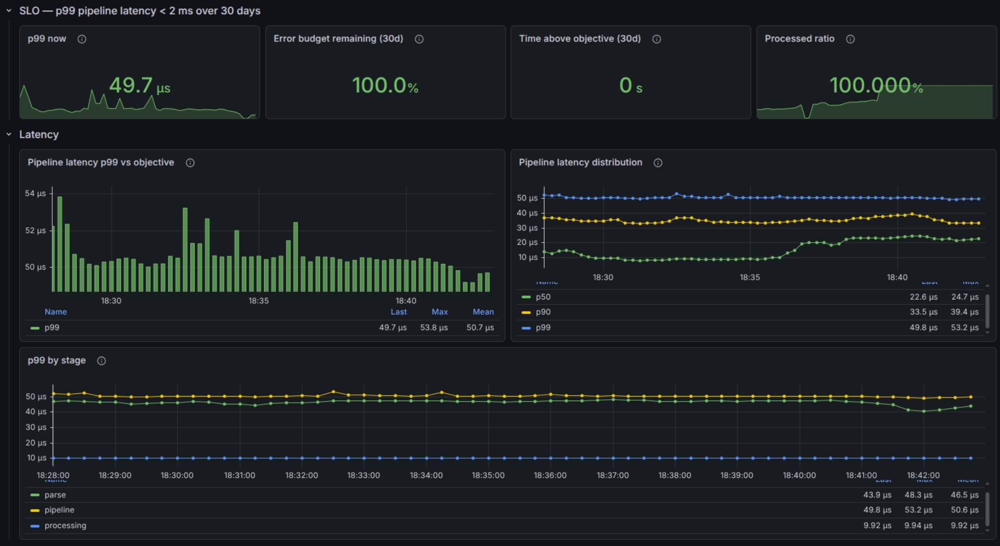

# low-latency-observability

> Real-time market data ingestion pipeline (Binance `aggTrade`), instrumented to measure p99 latency, with SLO, error budget and alerting on a GitOps-managed Kubernetes cluster.

[](https://github.com/Rysekk/low-latency-observability/actions)

An SRE learning project focused on observability and latency, from the Go code to a Kubernetes cluster managed by ArgoCD. Technical choices are documented in [`docs/decisions.md`](docs/decisions.md).

---

## Architecture

### Runtime

```
Binance WebSocket Stream (aggTrade / BTCUSDT)
         │  push, persistent connection
         ▼
  ┌──────────────────────────────────────────┐
  │  Go application (cmd/ingestor)           │
  │                                          │
  │  readStream goroutine                    │
  │         │                                │
  │         ▼  buffered channel (128)        │
  │      [ ■ ■ ■ □ □ ]  full -> DROP         │
  │         │           + ingest_message_    │
  │         │             dropped_total      │
  │         ▼                                │
  │  parse -> processing                     │
  │  (json)   (decimal.Decimal, time.Time)   │
  │    │         │                           │
  │    └────┬────┘                           │
  │         ▼  HistogramVec{stage}           │
  │      /metrics  (:8080)                   │
  └─────────┬────────────────────────────────┘
            │ scrape (10s)
            ▼
  ┌──────────────────────┐      ┌──────────────────────┐
  │  Prometheus          │<-----|  Grafana             │
  │  recording rules     │      │  provisioned         │
  │  alerting rules      │      │  dashboards (Git)    │
  │  TSDB PVC, 30d       │      │  PVC (SQLite)        │
  └──────────┬───────────┘      └──────────┬───────────┘
             │                             │
             └──────────┬──────────────────┘
                        ▼
         Traefik (Ingress, NodePort :30080)
   grafana.local / prometheus.local / argocd.local
                        ▲
                        │ WireGuard tunnel (10.8.0.1)
                     laptop
```

**Cluster**: single-node k3s on an Oracle A1 ARM VM in prod ([ADR 30](docs/decisions.md#30-single-node-k3s-in-production)). Application namespace `trading-app`. One Deployment and one Service per component, persistent volumes through the `local-path` StorageClass.

### Delivery

```
  git push (cmd/**, build/**, go.*)
            │
            ▼
  ┌──────────────────────────────┐
  │  GitHub Actions              │
  │  vet -> test  (gate)         │
  │        │                     │
  │        ▼                     │
  │  build + push ghcr.io:<SHA>  │
  │        │                     │
  │        ▼  yq                 │
  │  bump image in               │
  │  deploy/k8s/app/deployment   │
  │  commit "[skip ci]"          │
  └────────┬─────────────────────┘
           │ git
           ▼
  ┌──────────────────────────────┐
  │  ArgoCD  (app-of-apps)       │
  │                              │
  │  root ──> traefik            │
  │       ──> trading-app        │
  │       ──> prometheus         │
  │       ──> grafana            │
  │       ──> ingress            │
  │       ──> argocd (itself)    │
  │                              │
  │  prune: true, selfHeal: true │
  └────────┬─────────────────────┘
           │ reconcile
           ▼
        Cluster
```

Git is the only write path to the cluster. `make up` is a bootstrap.

---

## SLO and error budget

| | |
|---|---|
| **SLI** | Latency of the `pipeline` stage (receive to end of processing), measured with a histogram |
| **SLO** | p99 below **2 ms** over a rolling **30 day** window |
| **Error budget** | Roughly 43 min per month of allowed breach |
| **Alerts** | `page_high_latency_pipeline_p99` above 2 ms, `warning_high_latency_pipeline_p99` above 0.5 ms. Both `for: 10m`, `keep_firing_for: 5m` |
| **Actual window** | Since 2026-08-11, when the TSDB became persistent |

SLIs are recording rules (`ingest:processed_ratio`, `ingest:admission_ratio`, `ingest:pipeline_latency_p99`).

The 0.5 ms warning is an early signal and not part of the SLO. The `dash-slo` dashboard computes budget consumption from the p99 rule over 30 days. Downtime doesn't consume budget yet because the series is just missing when the app is down. A no-data alert is in the backlog.

### Exposed metrics

| Metric | Type | Purpose |
|---|---|---|
| `ingest_duration_seconds{stage}` | Histogram | Per-stage latency, `queue` / `parse` / `processing` / `pipeline`. 13 explicit buckets up to 100 ms |
| `ingest_message_receive_total` | Counter | Messages read off the socket, SLI denominator |
| `ingest_message_dropped_total` | Counter | Messages discarded on a full channel, SLI numerator |
| `ingest_message_malformed_total` | Counter | Malformed messages: payloads that cannot be decoded as JSON |
| `ingest_trade_invalid_total` | Counter | Invalid trades: decoded messages whose price, quantity or time cannot be converted |



---

## Timeline

| | |
|---|---|
| **Jul 11** | First real-time feed received (`aggTrade` WebSocket) |
| **Jul 19** | Three-stage instrumentation, full Go to Prometheus to Grafana chain working |
| **Jul 25** | Multi-stage `scratch` image (~8.5 MB), docker-compose stack |
| **Jul 26** | SLO, recording rules and alerting rule |
| **Aug 02** | Kubernetes migration (k3d) for the Go app and Prometheus, graceful SIGTERM shutdown |
| **Aug 10** | Grafana provisioned as code, read-only root filesystem |
| **Aug 11** | Persistent volumes (dynamic PVCs), start of the real SLO window |
| **Aug 15** | Exposure through Ingress and Traefik, port-forwards retired |
| **Aug 28** | CI on GitHub Actions, tests green on push to `main` |
| **Aug 29** | Trades parsed into `decimal.Decimal` and `time.Time`, image build and push to GHCR in CI |
| **Aug 30** | CI bumps the image SHA in the manifest, ArgoCD deploys it |
| **Sep 05** | ArgoCD app-of-apps with auto sync, Traefik under ArgoCD, CI path filter |
| **Sep 13** | Terraform for the Oracle infrastructure (network and VM) |
| **Sep 19** | Single-node k3s running on the Oracle VM, same app-of-apps |
| **Oct 10** | WireGuard tunnel to the VM, server key stored in Object Storage ([ADR 31](docs/decisions.md#31-private-access-through-wireguard-server-key-in-object-storage)) |
| **Oct 18** | Traefik as NodePort, since nothing provisions a `LoadBalancer` on the VM ([ADR 32](docs/decisions.md#32-traefik-exposed-as-a-nodeport)) |
| **Oct 18** | ArgoCD manages itself and is exposed through an Ingress ([ADR 33](docs/decisions.md#33-argocd-manages-itself)), k3d dev environment paused, pending a dedicated dev machine |
| **Oct 24** | Backlog and ADRs reorganised; the SLI now includes queue wait ([ADR 36](docs/decisions.md#36-the-slo-measures-pipeline-latency-including-queue-wait)) |
| **Oct 25** | Metrics follow the [glossary](GLOSSARY.md): parse counters renamed to *malformed message* and *invalid trade*, and the loss ratio split into an admission ratio (drops) and a processed ratio (trades out of messages received) |

---

## Deploying to Oracle Cloud

`deploy/terraform/` creates the network, an A1 ARM VM (2 OCPU / 12 GB) and a bucket for the WireGuard server key. Only WireGuard (UDP 51820) is open, and only from `my_ip`. SSH goes through the tunnel. On first boot, cloud-init sets up WireGuard, installs k3s and Helm, clones the repo and runs `make up`.

### 1. Provision

```bash
cd deploy/terraform
terraform init
terraform apply   # needs terraform.tfvars, see variables.tf
```

`terraform apply` is the only manual step: cloud-init runs `make up` on first boot, nothing has to be launched by hand on the VM. `make up` installs ArgoCD (chart `10.4.2`) and applies `deploy/argocd/root.yaml`. ArgoCD then deploys the rest from `deploy/argocd/apps/`, including itself with `deploy/helm/argocd-values.yaml`.

### 2. WireGuard tunnel

The server key lives in the bucket, so rebuilding the VM doesn't change it and the laptop config keeps working.

```ini
# /etc/wireguard/wg0.conf on the laptop
[Interface]
PrivateKey = <laptop private key>
Address    = 10.8.0.2/24

[Peer]
PublicKey  = <bucket-wireguard/wg/publickey>
Endpoint   = <instance_ip_public>:51820
AllowedIPs = 10.8.0.1/32
```

```bash
sudo wg-quick up wg0
ping 10.8.0.1
```

### 3. Access

Traefik is a `NodePort` (`web` on **30080**, `websecure` on 30443, see `deploy/helm/traefik-values.yaml`) and routes by host. Point the hosts at the tunnel IP only, without also listing them on the `127.0.0.1` line:

```
# /etc/hosts
10.8.0.1  argocd.local grafana.local prometheus.local
```

| Service | URL | Ingress |
|---|---|---|
| ArgoCD | http://argocd.local:30080 | `deploy/k8s/ingress/ingress-argocd.yaml` |
| Grafana | http://grafana.local:30080 | `deploy/k8s/ingress/ingress-monitoring.yaml` |
| Prometheus | http://prometheus.local:30080 | `deploy/k8s/ingress/ingress-monitoring.yaml` |

ArgoCD runs with `server.insecure: true`, so TLS is not terminated (HTTP only through the tunnel). Get the `admin` password on the VM (`ssh ubuntu@10.8.0.1`), change it after the first login, then delete the secret:

```bash
kubectl -n argocd get secret argocd-initial-admin-secret \
  -o jsonpath="{.data.password}" | base64 -d
kubectl get applications -n argocd   # all Synced / Healthy
```

If a URL doesn't load, `curl -H "Host: argocd.local" http://10.8.0.1:30080/` tells apart a cluster problem (no `200`) from a local DNS problem (`200`).

---

## Continuous integration

`.github/workflows/ci.yml`, triggered on push to `main` restricted to `cmd/**`, `build/**`, `go.*` and the workflow file itself, so documentation and manifest changes do not rebuild an image.

1. `lintAndTest`: `go vet ./...` then `go test ./...` on Go 1.26.5
2. `build-push`, gated on the previous job: builds `build/Dockerfile` with Buildx for amd64 and arm64 and pushes `ghcr.io/rysekk/low-latency-observability:<commit SHA>`
3. Same job: `yq` rewrites the image reference in `deploy/k8s/app/deployment.yaml` and commits it back with `[skip ci]`

The write-back uses the default `GITHUB_TOKEN` on purpose. A PAT would let the resulting commit retrigger the workflow and loop ([ADR 27](docs/decisions.md#27-sha-tag-ci-over-argo-image-updater)).

---

## Repository layout

```
cmd/ingestor/            Go application and its tests
build/Dockerfile         multi-stage build down to scratch
deploy/
  argocd/
    root.yaml            app-of-apps root Application
    apps/                one Application per component
  k8s/
    app/                 ingest-app Deployment and Service
    monitoring/          prometheus, grafana
    ingress/             Ingresses for ArgoCD, Grafana, Prometheus
  helm/                  Traefik and ArgoCD values consumed by ArgoCD via $values
  compose/               docker-compose stack, kept for local iteration
  terraform/             Oracle Cloud infra (VCN, VM, WireGuard key bucket) and cloud-init
observability/           Prometheus config and rules, Grafana provisioning
docs/                    decisions.md, backlog.md, JOURNAL.md
```

---

## Stack

**Application**: Go 1.26.5, `coder/websocket`, `prometheus/client_golang`, `shopspring/decimal`

**Observability**: Prometheus 3.13 (recording and alerting rules, 30d retention), Grafana 13 (provisioned through ConfigMaps)

**Infrastructure**: Terraform on Oracle Cloud (A1 ARM VM, k3s, WireGuard, Object Storage), Kubernetes (k3s), ArgoCD (Helm chart `argo-cd` 10.4.2), Traefik (Helm chart 41.2.0, NodePort), `local-path` PVCs

**Distribution**: multi-stage `scratch` image (~8.5 MB), published to `ghcr.io/rysekk/low-latency-observability`

**Hardening**: `runAsNonRoot` (65534), `readOnlyRootFilesystem`, all capabilities dropped, `GOMEMLIMIT` set below the memory limit so the GC reacts before the OOM killer does

Planned work: [`docs/backlog.md`](docs/backlog.md)

---

## Known limitations

- **Single node**: a VM or hypervisor failure takes the whole cluster down ([ADR 30](docs/decisions.md#30-single-node-k3s-in-production))
- **No TLS, no auth**: Grafana is anonymous admin, Prometheus has no access control, ArgoCD runs `server.insecure`. Acceptable only because everything is reachable through the tunnel alone
- **Single access path**: if `my_ip` or the ephemeral public IP changes, the tunnel is down until `terraform apply` is re-run
- **Non-standard port**: URLs need `:30080` until an Oracle load balancer replaces the NodePort. Ingresses have no `ADDRESS` and stay `Progressing` in ArgoCD ([ADR 32](docs/decisions.md#32-traefik-exposed-as-a-nodeport))
- **WireGuard key in a plain bucket**: protected by IAM only, no Vault encryption or rotation ([ADR 31](docs/decisions.md#31-private-access-through-wireguard-server-key-in-object-storage))
- **Firewall rule not persisted**: the UDP 51820 `iptables` rule is added by cloud-init once per instance, so a reboot of the same VM cuts the tunnel
- **A1 capacity**: Always Free A1 often returns "Out of host capacity", so a rebuild can take several `terraform apply` attempts
- **Downtime does not burn the error budget**: no no-data alert yet, see [SLO](#slo-and-error-budget)

Planned fixes are in [`docs/backlog.md`](docs/backlog.md).

---

## Documentation

- [`docs/decisions.md`](docs/decisions.md): technical decision records
- [`docs/backlog.md`](docs/backlog.md): planned work and accepted debt

---

## License

[MIT](LICENSE)
